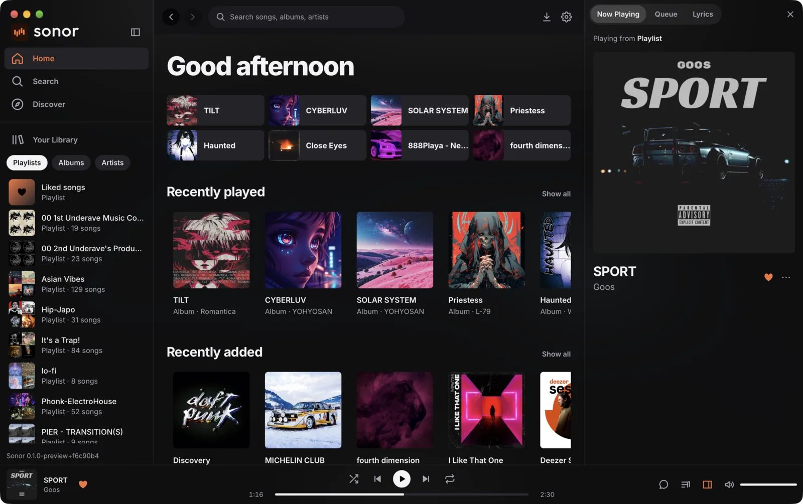
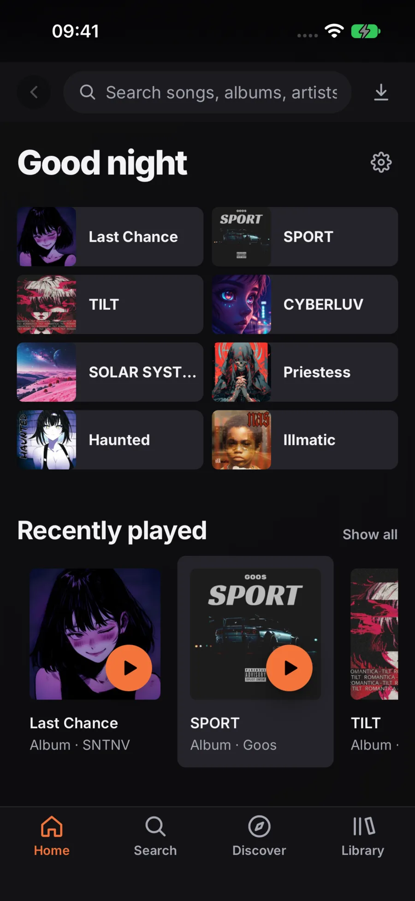
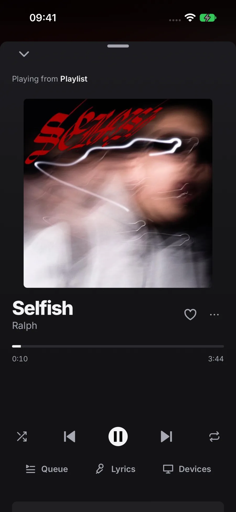
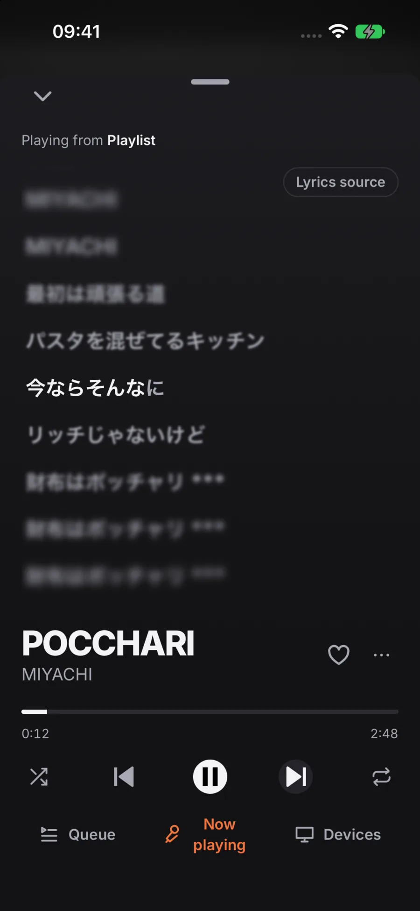
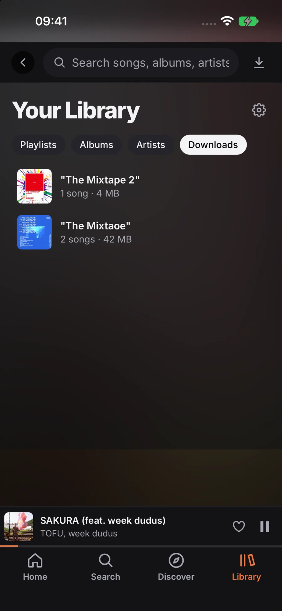

  <picture>
    <source media="(prefers-color-scheme: dark)" srcset=".github/assets/sonor-logo-on-dark.svg">
    <source media="(prefers-color-scheme: light)" srcset=".github/assets/sonor-logo-on-light.svg">
    
  </picture>

  <strong>A music player for the music server you already run.</strong> 
  macOS · Windows · Linux · Android · iOS

  <a href="https://sonor.fi"><strong>Download the beta</strong></a>

  

Sonor plays your own music library from a server you already run: Subsonic and OpenSubsonic
servers (Navidrome, Gonic, Airsonic, Ampache, LMS and others), Jellyfin and Emby. It runs on
desktop (macOS, Windows, Linux) and mobile (Android with Android Auto, iOS with CarPlay).

- Gapless playback, play next and add to the queue, likes and playlists.
- Downloads for offline listening, and the next songs cached ahead as you play.
- Lyrics, and the system's media keys and now-playing controls on every platform.

This repository holds what is published for it: the public beta builds and the LGPL source
bundles of the libraries its desktop apps include. Sonor's own source code is not public.

## Screenshots

**Desktop**

  

**Mobile**

  
  
  
  

## Public beta

Download the latest beta from [Releases](https://github.com/sonorhq/sonor/releases). Each beta
ships for:

| Platform | File |
| --- | --- |
| macOS (Apple silicon) | `…-macos.dmg`, signed and notarised |
| Windows (x86-64) | `…-windows-setup.exe` |
| Linux (x86-64) | `…-x86_64.AppImage`, or `…-x86_64.pkg.tar.zst` for Arch |
| Android (arm64) | `…-android.apk` |

iOS betas go through TestFlight.

**Every beta build expires 90 days after it is built.** The app warns two weeks before, and once
expired it shows a notice and no longer plays music. Download the newest beta from Releases to
keep going. The release notes give each build's expiry date.

Notes for installing:

- **Windows:** the installer is not code-signed yet, so SmartScreen may warn. Choose
  *More info* → *Run anyway*.
- **Linux:** make the AppImage executable (`chmod +x Sonor-*.AppImage`) and run it. On Arch,
  run `sudo pacman -U sonor-*.pkg.tar.zst`.
- **Android:** allow installing from your browser or file manager, then open the APK.

Check a download against the release's `SHA256SUMS` with `shasum -a 256 -c SHA256SUMS`.

These are betas: expect bugs. To report one, or to suggest something,
[open an issue](https://github.com/sonorhq/sonor/issues).

## LGPL source bundles

Sonor's desktop builds (macOS, Linux, Windows) include libmpv, FFmpeg and other libraries
licensed under the GNU Lesser General Public License. Sonor itself is not open source, but those
libraries are separate files inside the installed app (dynamically linked), so you may swap them
for your own builds of the same libraries.

Each release carries, per desktop platform, a `sonor-libmpv-sources-<target>.tar` file. It holds:

- the exact source code of those libraries;
- the patches applied;
- the build scripts and configuration;
- the licence texts;
- `README-REBUILD.txt`, which explains how to rebuild the libraries and replace them in an
  installed copy of Sonor.

Check each bundle against `SHA256SUMS`. The release tag matches the Sonor version the bundles
were built for. To ask for the source in another form, open an issue in this repository.

## Licence

Sonor is proprietary software. The terms of use are in the EULA shipped with each build. The
LGPL libraries keep their own licences, included in the bundles above.
